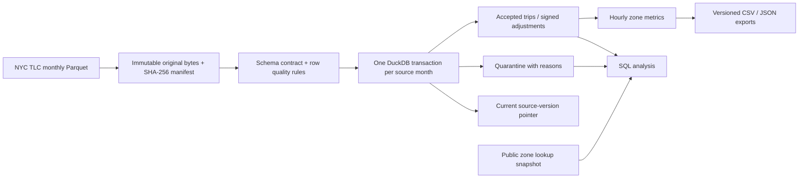
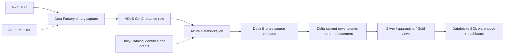

# Urban Mobility Lakehouse

**A tested local implementation with an Azure Databricks deployment target.** Historical NYC taxi records become traceable monthly snapshots, quarantined exceptions and hourly demand/charge metrics. Replaying a file does not duplicate facts; replacing a corrected source changes only its month.

> **Delivery status:** local Python/DuckDB execution and public-source validation are recorded in [VALIDATION.md](docs/VALIDATION.md). Azure resources have **not** been deployed. Delta, Unity Catalog permissions, cloud performance, networking and cloud recovery are **unvalidated**. This is not a claim of a production deployment. No subscription is needed for the local quickstart.

## Business question

A mobility analyst needs to compare pickup demand by zone and hour without counting repeated deliveries twice, silently discarding financial adjustments, or mixing old and corrected monthly files. TLC does not supply a universal trip identifier. This project makes that ambiguity visible: physical source rows are the grain, and possible duplicates remain available for analysis.

Why now: the MTA's [October 2026 transport investment update](https://www.mta.info/agency/bridges-and-tunnels/congestion-relief-zone/better-transit) keeps reliable mobility evidence relevant to planning. This implementation deliberately uses **January–March 2024 historical data** from the selected project blueprint. It does not estimate congestion-pricing effects or represent current traffic. See [sources and reuse](docs/SOURCES.md).

## Architecture and stack



The **Azure target** preserves the guide's architecture:



| Component | Local implementation | Azure target and rationale |
|---|---|---|
| Python | CLI, contract enforcement, download limits, manifests, tests | Original PySpark job adapter; orchestration and operational evidence |
| PyArrow | Parquet schema inspection and reproducible synthetic fixtures | Retains source row position when building Bronze |
| DuckDB + SQL | Single-machine transactional monthly replacement and analytical views | Local substitute, **not a Delta emulator** |
| ADLS + ADF | Public HTTP downloader and content-addressed local raw store | Managed-identity binary ingestion into retained raw paths |
| Databricks + Delta + Unity Catalog | Cloud assets included; execution pending | Atomic Delta slice replacement, governed tables and SQL serving |
| Bicep + Azure DevOps | Foundation compilation and gated deployment definitions | Declarative cloud foundation; production network path deliberately blocked |
| GitHub Actions + unittest | Credential-free deterministic checks | Does not create Azure resources or run cloud acceptance tests |

Local SQL and cloud Spark logic are separate implementations of the same intended contract. Runtime equivalence still needs a cloud comparison on the synthetic fixture before release. Details, bootstrap prerequisites, grants, dashboard queries and gaps: [Azure runbook](docs/AZURE.md).

## Run locally

Python 3.12 or 3.14 recommended. Commands run from the repository root on macOS/Linux; Windows users can use WSL. Dependencies are pinned in `pyproject.toml`.

```bash
python3 -m venv .venv
source .venv/bin/activate
python -m pip install .
python -W error::ResourceWarning -m unittest discover -s tests -v

# Six invented trips, never represented as real NYC observations.
python scripts/generate_fixture.py --output data/fixtures/synthetic.parquet
mobility-lakehouse ingest --file data/fixtures/synthetic.parquet \
  --month 2024-01 --data-dir data/demo
mobility-lakehouse report --data-dir data/demo

# Public historical data: use a separate warehouse from the synthetic demo.
mobility-lakehouse fetch --month 2024-01 --data-dir data/live
mobility-lakehouse fetch --month 2024-02 --data-dir data/live
mobility-lakehouse fetch --month 2024-03 --data-dir data/live
mobility-lakehouse report --data-dir data/live
python scripts/run_queries.py --data-dir data/live
```

Run a second `fetch` or ingest the retained file to exercise idempotency. A successful unchanged source returns `replayed: true`; audit events and report generations may grow, business facts do not. Fetches require internet access; tests and the synthetic demo do not. Three real monthly inputs require additional disk space for the raw files, database, intermediate sorts and report generations. Keep one writer/exporter per data directory.

## Contracts and metrics

- **Identity:** source month + SHA-256 + zero-based physical Parquet row. It identifies a record in a delivered file, not a unique real-world ride. Corrections are whole-file source versions.
- **Quality:** invalid/null meter times, pickup outside the declared month, nonpositive duration, invalid zone IDs, nonfinite/negative distance and unusable monetary amounts quarantine. Accepted plus quarantined rows must equal raw rows. See the [data dictionary](docs/DATA_MODEL.md) for exact handling.
- **Money:** USD cents using `DECIMAL(18,2)` and declared rounding. Negative fare or total marks a signed financial adjustment; it remains in accepted data if the other rules pass. Recorded total charges exclude cash tips and are not profit.
- **Duplicates:** repeated modeled values are candidate duplicates, retained in full. A downstream analyst can inspect their magnitude without silently deleting legitimate repeated rides.
- **Time:** the source has timezone-naive NYC civil timestamps. Hours and durations are wall-clock descriptions, not DST-correct elapsed-time measurements. No speed or precise journey-time performance claim is made.
- **History:** raw originals and manifests retain prior versions. Current tables point to one version per month. Reverting to a previously superseded version requires explicit `--allow-revert` after investigation.

The [SQL examples](sql/analysis.sql), [zone-aware query runner](scripts/run_queries.py), and committed [aggregate evidence](examples/) make outputs inspectable. The synthetic six-row example yields four accepted rows and two quarantined rows; the two identical fixture rides remain separate.

The observed three-month run processed **9,554,778 real source records**: 9,551,921 accepted and 2,857 quarantined. It retained 136,895 signed-adjustment records and one candidate duplicate. Replays preserved business-table fingerprints; 304,196 hourly CSV rows were checked against SQL. The 43 local tests include pipeline, pure cloud-contract and normalization-parity checks; none execute Azure. Full evidence and limits: [VALIDATION.md](docs/VALIDATION.md).

## Reliability and operations

Each source is archived before transformation. Required schema/type changes fail with a controlled error and preserve the last committed month. Additive fields are catalogued and remain in raw data. The local transaction replaces accepted/quarantined rows and the current-source pointer together; Gold reads committed current data. A failure after deletion or insertion rolls back the whole business change.

Reports use a new generation directory and an atomic `latest.json` pointer after database commit. If reporting fails, the database can be newer than the last published report; rerun `report` or replay the same source to recover. This intentionally avoids pretending that a filesystem export and a database commit form one distributed transaction. See [operations and recovery](docs/OPERATIONS.md).

The cloud adapter uses a single Delta current-rows table with views over accepted, quarantined and aggregated rows to avoid publishing mismatched Silver/Gold versions. Sequential statements across different Delta tables do not constitute a multi-table transaction. Cloud failure tests are still pending.

## Validation and boundaries

The definitive observed results, source checksums and checks run are in [VALIDATION.md](docs/VALIDATION.md). The suite exercises corrected-month replacement, duplicate preservation, malformed schema, signed rounding, replay, revert protection, real transaction rollback and report recovery. No throughput SLA or production security claim is inferred from these local checks.

Important limits: single writer; three-month source allowlist; current facts with retained raw history, rather than a full bitemporal warehouse; no source-guaranteed trip key; possible source errors; permissive outlier policy for unusually long/expensive trips; current zone labels applied to historical trips; no causal transport conclusions. Raw retention consumes disk until an operator reviews a retention policy. Cloud private endpoints, account-level Unity Catalog setup, full orchestration and live acceptance evidence are explicitly tracked in the Azure runbook.

## Explain this project in an interview

1. **Why not deduplicate on time and zones?** Those fields are not a guaranteed trip key. Preserve physical rows and expose candidate duplicates.
2. **Why replace a month?** A corrected monthly file is authoritative for that source slice; an append-only load would double-count. The transaction swaps only that slice.
3. **What does exactly-once mean here?** Repeated committed bytes produce the same business state under one writer. It does not mean HTTP requests or audit events occur once.
4. **Why separate financial adjustments?** Dropping negative values biases signed charge totals. They are retained and separately visible without assuming their business cause.
5. **How do you recover?** Reprocess immutable raw bytes after fixing the contract or runtime issue; regenerate exports from committed state; use a controlled revert only when justified.
6. **What would block a production launch?** Unverified cloud IAM/networking, resource quotas/costs, actual runtime parity, concurrency, retention, recovery and measured acceptance tests. Templates alone are insufficient evidence.

Original implementation: MIT. Public data attribution and terms: [SOURCES.md](docs/SOURCES.md). Inspired by the user-selected Azure project guide, with independent code and explicit delivery stages.
